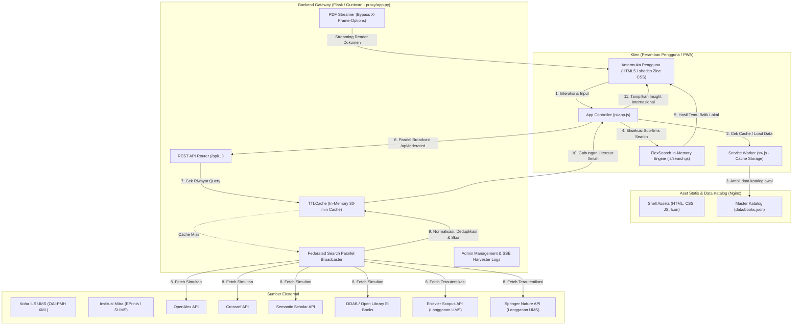

# 🏛️ Arsitektur Sistem & Filosofi Desain (System Architecture)
> **UMS Library OneSearch (harvest-koha)**  
> Dokumentasi arsitektur perangkat lunak, filosofi *Zero-Framework*, mesin temu balik klien, dan sistem federasi ilmiah.

---

## 📑 Daftar Isi
1. [Filosofi Arsitektur Zero-Framework](#1-filosofi-arsitektur-zero-framework)
   - [Mengapa Tanpa React, Vue, atau Vite?](#mengapa-tanpa-react-vue-atau-vite)
   - [Mengapa Tanpa Tailwind CSS CLI?](#mengapa-tanpa-tailwind-css-cli)
   - [Manfaat Ketahanan Jangka Panjang (*Longevity & Zero Dependency Rot*)](#manfaat-ketahanan-jangka-panjang-longevity--zero-dependency-rot)
2. [Diagram Topologi & Alur Data Sistem](#2-diagram-topologi--alur-data-sistem)
3. [Mesin Temu Balik In-Memory Klien (`js/search.js`)](#3-mesin-temu-balik-in-memory-klien-jssearchjs)
   - [Struktur Indeks FlexSearch & Pembobotan Field](#struktur-indeks-flexsearch--pembobotan-field)
   - [Mekanisme Ekstraksi Facet Dinamis & Filter](#mekanisme-ekstraksi-facet-dinamis--filter)
4. [Arsitektur Penelusuran Ilmiah Internasional (Federated Broadcasting)](#4-arsitektur-penelusuran-ilmiah-internasional-federated-broadcasting)
   - [Eksekusi Paralel & Agregasi Sumber](#eksekusi-paralel--agregasi-sumber)
   - [Deduplikasi Berbasis DOI & Normalisasi Judul](#deduplikasi-berbasis-doi--normalisasi-judul)
   - [Strategi Caching Berjenjang (TTLCache)](#strategi-caching-berjenjang-ttlcache)
5. [Spesifikasi Design System (shadcn Zinc Vanilla CSS)](#5-spesifikasi-design-system-shadcn-zinc-vanilla-css)
   - [Desain Token Kontrak Warna (Light & Dark Mode)](#desain-token-kontrak-warna-light--dark-mode)
   - [Kelas Komponen Terstandarisasi](#kelas-komponen-terstandarisasi)
6. [Resiliensi PWA & Strategi Cache Service Worker](#6-resiliensi-pwa--strategi-cache-service-worker)

---

## 1. Filosofi Arsitektur Zero-Framework

Salah satu keputusan teknis paling krusial dalam rancangan **UMS Library OneSearch** adalah ketiadaan framework JavaScript modern yang lazim ditemui di ekosistem frontend (seperti React, Next.js, Nuxt, Vue, Angular, atau Svelte), serta peniadaan bundler build tools (Vite, Webpack, Rollup).

### Mengapa Tanpa React, Vue, atau Vite?
1. **Performa Instan Tanpa Hydration Cost**:
   Aplikasi perpustakaan digunakan oleh puluhan ribu mahasiswa dan dosen melalui berbagai jenis perangkat, termasuk smartphone berspesifikasi rendah (*budget phones*) dan komputer workstation perpustakaan lama. Pada framework modern, peramban harus mengunduh paket bundel JS berukuran ratusan kilobyte, mengevaluasi JavaScript, lalu melakukan proses *DOM hydration*. Pada sistem ini, HTML dan Vanilla JS dievaluasi secara instan oleh engine V8/JavaScriptCore tanpa overhead komputasi virtual DOM.
2. **Kinerja PWA Offline Sejati**:
   Seluruh shell antarmuka terdiri dari file statis murni (`index.html`, `css/style.css`, `js/app.js`, `js/search.js`). Service Worker dapat mencache file-file ini secara deterministik tanpa perlu menangani *code-splitting chunks* dinamis yang berisiko gagal dimuat saat jaringan terputus (*chunk load error*).
3. **Kemudahan Deployment**:
   Menghilangkan kebutuhan pipeline CI/CD yang kompleks untuk `npm run build`. Aplikasi dapat dideploy cukup dengan menyalin file langsung ke direktori root Nginx atau server web manapun tanpa kompilasi.

### Mengapa Tanpa Tailwind CSS CLI?
Alih-alih menggunakan CLI compiler Tailwind yang memproduksi file output melalui build step, sistem ini mengimplementasikan **Design Tokens shadcn** langsung pada Vanilla CSS (`css/style.css`):
- Variabel CSS kustom (*CSS Custom Properties*) didefinisikan pada `:root` dan `.dark`.
- Gaya utilitas dan komponen (`.card`, `.btn`, `.badge`, `.input`, `.subtab-btn`) dibuat mengikuti spesifikasi desain shadcn Zinc secara konsisten.
- Pengembang dapat langsung mengedit styling dan melihat perubahannya seketika dengan me-refresh browser (*no watch process required*).

### Manfaat Ketahanan Jangka Panjang (*Longevity & Zero Dependency Rot*)
Proyek TI perpustakaan dan repositori kampus seringkali harus beroperasi stabil selama 5 hingga 10 tahun tanpa perombakan total. Masalah klasik framework frontend adalah *dependency rot*:
- Versi Node.js yang usang (misal Node 14 ke 20+) membuat build script gagal berjalan.
- Pembaruan library pihak ketiga menghasilkan *breaking changes* pada React ecosystem.
Dengan arsitektur **HTML5 + ES6 Modern + CSS3 murni**, kode sumber UMS OneSearch dijamin tetap dapat dieksekusi oleh web browser modern hingga puluhan tahun mendatang tanpa perlu perawatan dependensi npm.

---

## 2. Diagram Topologi & Alur Data Sistem



---

## 3. Mesin Temu Balik In-Memory Klien (`js/search.js`)

Kunci kecepatan sistem UMS OneSearch terletak pada eksekusi pencarian di sisi browser pengguna tanpa *network round-trip* ke database SQL.

### Struktur Indeks FlexSearch & Pembobotan Field
Pustaka `FlexSearch` diinisialisasi dengan konfigurasi dokumen multi-field di `js/search.js`. Setiap atribut bibliografi memiliki bobot relevansi (*boost factor*) yang berbeda:

```javascript
this.index = new FlexSearch.Document({
    document: {
        id: "id",
        index: [
            { field: "t",   tokenize: "forward", resolution: 9 }, // Judul Buku (Bobot Tertinggi)
            { field: "a",   tokenize: "forward", resolution: 5 }, // Penulis / Pengarang
            { field: "sub", tokenize: "forward", resolution: 4 }, // Kata Kunci Subjek
            { field: "ddc", tokenize: "exact",   resolution: 3 }, // Nomor Klasifikasi DDC
            { field: "isbn",tokenize: "exact",   resolution: 2 }, // Nomor Standar ISBN
            { field: "call",tokenize: "exact",   resolution: 1 }  // Call Number / No Panggil
        ]
    },
    tokenize: "forward",
    cache: 100
});
```

* **Tokenize `forward`**: Memungkinkan pencarian awalan kata (*prefix matching*), misal mengetik `"pemasar"` akan langsung mencocokkan `"pemasaran"`.
* **Tokenize `exact`**: Diterapkan pada DDC, ISBN, dan Call Number untuk mencegah kecocokan parsial yang tidak diinginkan pada kode alfanumerik.

### Mekanisme Ekstraksi Facet Dinamis & Filter
Ketika hasil pencarian diperoleh dari FlexSearch, controller (`js/app.js`) menjalankan fungsi `renderFacets()`:
1. Menghitung distribusi frekuensi untuk setiap kategori: Institusi (`src`), Format koleksi (`type`), Nama Pengarang (`a`), Tahun Terbit (`yr`), Subjek (`sub`), dan Kelas DDC (`ddcClass`).
2. Menghasilkan *checkbox facet* interaktif di bilah samping (*sidebar*).
3. Jika pengguna mencentang filter (misal memilih tahun `2024` dan format `Buku`), dataset disaring secara instan tanpa perlu mengindeks ulang dokumen.

---

## 4. Arsitektur Penelusuran Ilmiah Internasional (Federated Broadcasting)

Selain katalog lokal Koha UMS, sistem memiliki modul **Federated Scientific Discovery** yang dijalankan oleh backend Flask (`proxy/app.py`).

### Eksekusi Paralel & Agregasi Sumber
Pencarian artikel jurnal dan prosiding internasional menggunakan model *multi-threaded parallel broadcasting*:
1. Permintaan dari klien diterima di endpoint `/api/federated?q={query}`.
2. Worker thread mengeksekusi permintaan HTTP secara bersamaan menggunakan `requests` session ke:
   - **OpenAlex API**: Basis data ilmiah terbuka terbesar di dunia.
   - **Crossref API**: Metadata registrasi DOI global.
   - **Semantic Scholar API**: Pencarian graf akademis bertenaga AI.
   - **The Lens API**: Penelusuran literatur dan paten global.
   - **Elsevier Scopus API**: Menampilkan publikasi bereputasi tinggi yang dilanggan UMS (menggunakan institutional API Key).
   - **Springer Nature API**: Koleksi jurnal dan buku ilmiah Springer.
   - **DOAB & Open Library**: Khusus e-book ilmiah open-access.

### Deduplikasi Berbasis DOI & Normalisasi Judul
Artikel yang sama seringkali terdaftar di beberapa database sekaligus (misal artikel Scopus yang juga tercatat di OpenAlex dan Crossref).
- **Primary Deduplication Key**: DOI (*Digital Object Identifier*), dinormalisasi ke format huruf kecil murni (contoh: `10.1016/j.procs.2024.01.001`).
- **Secondary Deduplication Key**: Judul yang dibersihkan (*clean title hash*) jika DOI tidak tersedia (menghapus tanda baca, spasi berlebih, dan huruf besar).
- **Metadata Merging**: Sistem menggabungkan atribut terbaik dari berbagai sumber (misal mengambil tautan PDF open-access dari OpenAlex, namun memperkaya abstrak dari Scopus).

### Strategi Caching Berjenjang (TTLCache)
Untuk mematuhi batas kuota API (*rate limit*) pihak ketiga dan mempercepat waktu respons pengguna berulang:
- Backend memanfaatkan `cachetools.TTLCache` dalam memori server dengan batas durasi (*Time-To-Live*) 30 menit.
- Query pencarian yang identik akan dilayani seketika dalam waktu < 2 milidetik dari memori cache backend.

---

## 5. Spesifikasi Design System (shadcn Zinc Vanilla CSS)

Sistem menggunakan tema visual modern berbasis keluarga warna netral **Zinc** yang terinspirasi dari standar desain [shadcn/ui](https://ui.shadcn.com/).

### Desain Token Kontrak Warna (Light & Dark Mode)
Didefinisikan dalam variabel CSS murni di bagian atas `css/style.css`:

```css
:root {
    --background: 0 0% 100%;       /* Pure White #ffffff */
    --foreground: 240 10% 3.9%;    /* Dark Charcoal #09090b */
    --card: 0 0% 100%;             /* Card Background */
    --card-foreground: 240 10% 3.9%;
    --primary: 240 5.9% 10%;       /* Solid Zinc-900 */
    --primary-foreground: 0 0% 98%;/* Bright White Text */
    --muted: 240 4.8% 95.9%;       /* Soft Background #f4f4f5 */
    --muted-foreground: 240 3.8% 46.1%; /* Dimmed Subtitles #71717a */
    --border: 240 5.9% 90%;        /* Crisp Border #e4e4e7 */
    --radius: 0.5rem;              /* 8px Rounded Radius */
}

.dark {
    --background: 240 10% 3.9%;    /* Deep Zinc-950 #09090b */
    --foreground: 0 0% 98%;        /* White Zinc-50 #fafafa */
    --card: 240 10% 6%;            /* Card Zinc-900 #111113 */
    --card-foreground: 0 0% 98%;
    --primary: 0 0% 98%;           /* High-contrast Primary */
    --primary-foreground: 240 5.9% 10%;
    --muted: 240 3.7% 15.9%;       /* Dark Muted */
    --muted-foreground: 240 5% 64.9%;
    --border: 240 3.7% 18%;        /* Subtle Dark Border */
}
```

### Kelas Komponen Terstandarisasi

| Komponen | Kelas CSS Utama | Karakteristik Visual |
| :--- | :--- | :--- |
| **Tombol Utama** | `.btn.btn-brand` | Latar solid `var(--primary)`, teks kontras tinggi, elevasi halus, transisi hover aktif. |
| **Tombol Outline** | `.btn.btn-outline` | Border 1px `var(--border)`, latar transparan, warna teks dinamis. |
| **Kartu Buku** | `.card` / `.bk-card` | Border 1px crisp, background card terisolasi, hover lift halus, tipografi rapi. |
| **Input Pencarian** | `.input` / `.search-input` | Border netral, focus ring halus `var(--primary)`, placeholder teredam. |
| **Badge Kategori** | `.badge` / `.badge-secondary` | Radius pil (*pill radius*), ukuran font 12px, warna latar lembut untuk subjek & DDC. |
| **Segmented Tabs** | `.subtab-btn` | Tombol tab bergaya pill dalam wadah abu-abu (`.subtab-group`), status aktif berlatar putih dengan bayangan tipis. |

---

## 6. Resiliensi PWA & Strategi Cache Service Worker

File `sw.js` bertindak sebagai proxy jaringan di sisi klien yang mengimplementasikan dua jenis cache:

1. **`CACHE_NAME_SHELL` (Aset Statis)**:
   - Pola: *Cache-First with Network Fallback*.
   - Menyimpan `index.html`, `admin.html`, `css/style.css`, `js/app.js`, `js/search.js`, dan font.
   - Pemuatan halaman kedua dan seterusnya terjadi instan tanpa menunggu koneksi internet.
2. **`CACHE_NAME_DATA` (Data Bibliografi)**:
   - Pola: *Stale-While-Revalidate*.
   - Menyimpan file `data/books.json` dan `data/institutions.json`.
   - Menjamin pengguna selalu dapat mencari buku meskipun server offline, sembari mengunduh pembaruan katalog di latar belakang.

