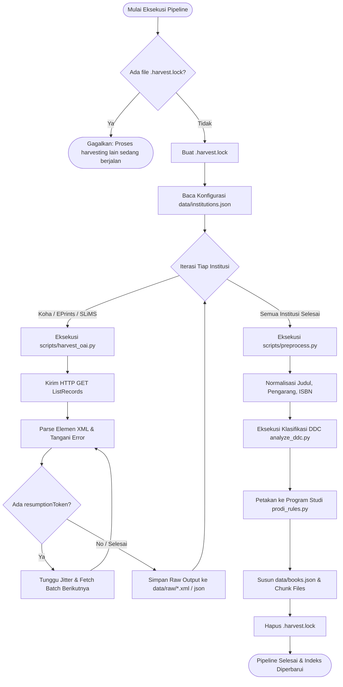

# 🌾 Pipeline Harvesting Data & Pra-Pemrosesan (Data Pipeline)
> **UMS Library OneSearch (harvest-koha)**  
> Dokumentasi teknis alur ekstraksi metadata OAI-PMH, normalisasi MARC21/Dublin Core, engine klasifikasi DDC/Prodi, dan strategi pembaruan otomatis.

---

## 📑 Daftar Isi
1. [Prinsip Kerja Protokol OAI-PMH](#1-prinsip-kerja-protokol-oai-pmh)
2. [Alur Kerja Pipeline End-to-End](#2-alur-kerja-pipeline-end-to-end)
3. [Arsitektur Harvester Universal (`scripts/harvest_oai.py`)](#3-arsitektur-harvester-universal-scriptsharvest_oaipy)
   - [Mekanisme Resumption Token & Paginasi Terdistribusi](#mekanisme-resumption-token--paginasi-terdistribusi)
   - [Strategi Penanganan Koneksi Putus & Exponential Backoff](#strategi-penanganan-koneksi-putus--exponential-backoff)
   - [Harvesting Inkremental Berbasis Tanggal (`--from`)](#harvesting-inkremental-berbasis-tanggal---from)
4. [Mesin Pra-Pemrosesan & Normalisasi (`scripts/preprocess.py`)](#4-mesin-pra-pemrosesan--normalisasi-scriptspreprocesspy)
   - [Pemetaan Elemen Dublin Core & Tag MARC21](#pemetaan-elemen-dublin-core--tag-marc21)
   - [Sanitasi Judul, Pengarang, dan Standarisasi ISBN](#sanitasi-judul-pengarang-dan-standarisasi-isbn)
   - [Struktur Skema Data JSON Ringkas (`data/books.json`)](#struktur-skema-data-json-ringkas-databooksjson)
5. [Mesin Klasifikasi DDC & Pemetaan Program Studi](#5-mesin-klasifikasi-ddc--pemetaan-program-studi)
   - [Ekstraksi & Validasi Nomor Panggil DDC (`scripts/analyze_ddc.py`)](#ekstraksi--validasi-nomor-panggil-ddc-scriptsanalyze_ddcpy)
   - [Aturan Pemetaan Prodi UMS (`scripts/prodi_rules.py`)](#aturan-pemetaan-prodi-ums-scriptsprodi_rulespy)
6. [Penjadwalan Otomatis & Kontrol Konkurensi (`.harvest.lock`)](#6-penjadwalan-otomatis--kontrol-konkurensi-harvestlock)

---

## 1. Prinsip Kerja Protokol OAI-PMH

**OAI-PMH** (*Open Archives Initiative Protocol for Metadata Harvesting*) adalah protokol standar global berbasis HTTP dan XML yang digunakan oleh sistem perpustakaan digital dan repositori institusi di seluruh dunia untuk mempertukarkan metadata bibliografi secara interoperabel.

Perintah (*verbs*) utama yang digunakan oleh pipeline UMS OneSearch:
- `Identify`: Memeriksa kapabilitas repositori, versi OAI, nama institusi, dan granularity timestamp tanggal.
- `ListMetadataFormats`: Mengidentifikasi format metadata yang didukung oleh endpoint target (`oai_dc` atau `marc21`).
- `ListRecords`: Menarik kumpulan rekaman bibliografi lengkap beserta metadata dan identifier dokumen.

---

## 2. Alur Kerja Pipeline End-to-End



---

## 3. Arsitektur Harvester Universal (`scripts/harvest_oai.py`)

Skrip `scripts/harvest_oai.py` dirancang untuk mampu berkomunikasi dengan beragam jenis sistem otomasi perpustakaan, antara lain:
- **Koha ILS**: Menggunakan endpoint `/cgi-bin/koha/oai.pl` (format `oai_dc` dan `marc21`).
- **EPrints Repositori**: Menggunakan endpoint `/cgi/oai2` (format `oai_dc`).
- **SLiMS (Senayan)**: Menggunakan plugin OAI `/oai.php`.
- **DSpace**: Menggunakan endpoint `/oai/request`.

### Mekanisme Resumption Token & Paginasi Terdistribusi
Koleksi perpustakaan universitas memiliki puluhan hingga ratusan ribu rekaman. Server OAI tidak mengirim seluruh rekaman dalam satu respons, melainkan membaginya per kelompok (batch) berkisar 50-500 rekaman:
1. Skrip meminta rekaman pertama:
   `GET /oai.pl?verb=ListRecords&metadataPrefix=oai_dc`
2. Server merespons dengan batch rekaman dan menyertakan tag XML penanda token:
   `<resumptionToken completeListSize="85420" cursor="0">ABCD12345XYZ</resumptionToken>`
3. Harvester mengekstrak string token dan mengirimkan permintaan batch lanjutan secara rekursif:
   `GET /oai.pl?verb=ListRecords&resumptionToken=ABCD12345XYZ`
4. Siklus berulang hingga elemen `<resumptionToken>` kosong atau tidak ditemukan lagi di respons XML terakhir.

### Strategi Penanganan Koneksi Putus & Exponential Backoff
Server perpustakaan seringkali mengalami lonjakan beban atau *timeout* saat memproses database bibliografi besar. Harvester mengimplementasikan proteksi cerdas:
- **Jitter Delay**: Memberikan jeda 0.5 - 1.5 detik antar batch untuk mencegah pemblokiran oleh Web Application Firewall (WAF) kampus.
- **Retry Mechanism**: Jika terjadi error `500 Internal Server Error`, `503 Service Unavailable`, atau koneksi terputus, skrip menunggu dengan skema *exponential backoff* (2 detik, 4 detik, 8 detik, hingga 16 detik) sebelum mencoba kembali token yang sama hingga maksimal 5 kali percobaan.

### Harvesting Inkremental Berbasis Tanggal (`--from`)
Alih-alih memanen ulang seluruh database dari nol setiap hari (yang memakan waktu berjam-jam), sistem mendukung harvesting pembaruan inkremental:
```bash
python scripts/harvest_all.py --from 2026-11-01
```
Perintah ini menginstruksikan server OAI untuk hanya mengirimkan rekaman yang dibuat atau diubah sejak tanggal `2026-11-01T00:00:00Z`.

---

## 4. Mesin Pra-Pemrosesan & Normalisasi (`scripts/preprocess.py`)

File XML mentah hasil harvesting OAI masih mengandung format yang tidak seragam, karakter kontrol tersembunyi, serta struktur data berukuran besar. Skrip `scripts/preprocess.py` bertanggung jawab menyatukan dan menyederhanakan data tersebut.

### Pemetaan Elemen Dublin Core & Tag MARC21
Parser mengekstrak atribut penting dengan prioritas pemetaan ganda:

| Bidang Bibliografi | Elemen Dublin Core (`oai_dc`) | Tag MARC21 |
| :--- | :--- | :--- |
| **Judul Buku** | `dc:title` | Tag `245$a`, `245$b` |
| **Pengarang / Penulis** | `dc:creator`, `dc:contributor` | Tag `100$a`, `700$a` |
| **Subjek / Topik** | `dc:subject` | Tag `650$a`, `653$a` |
| **Nomor DDC** | `dc:subject` (regex pola DDC) | Tag `082$a`, `090$a` |
| **Nomor ISBN** | `dc:identifier` (regex ISBN) | Tag `020$a` |
| **Tahun Publikasi** | `dc:date` (regex tahun 4 digit) | Tag `260$c`, `264$c` |
| **Penerbit** | `dc:publisher` | Tag `260$b`, `264$b` |
| **Tautan Akses OPAC** | `dc:identifier` (URL format) | Tag `856$u` |

### Sanitasi Judul, Pengarang, dan Standarisasi ISBN
- **Pembersihan Judul**: Menghapus sisa tanda baca MARC21 yang mengganggu pengalaman pengguna (misal tanda garis miring `/` di akhir judul yang menandakan pengarang, tanda titik dua `:`, atau tanda titik ganda).
- **Normalisasi Pengarang**: Mengubah format penulisan terbalik katalog (contoh: `"Suryono, Bambang"` diubah menjadi nama ramah baca `"Bambang Suryono"` sembari tetap mengindeks kedua variasi nama).
- **Validasi ISBN**: Menghilangkan tanda hubung strip `-`, spasi kosong, serta melakukan konversi dan validasi checksum ISBN-10 ke ISBN-13.

### Struktur Skema Data JSON Ringkas (`data/books.json`)
Untuk memangkas ukuran transfer data jaringan bagi klien, nama properti dalam JSON dipersingkat menjadi kode pendek:

```json
[
  {
    "id": "ums-koha-104921",
    "t": "Pemrograman Web Modern Berbasis JavaScript",
    "a": "Budi Santoso",
    "yr": 2024,
    "sub": ["JavaScript", "Web Development", "Pemrograman"],
    "ddc": ["005.133"],
    "src": "Perpustakaan UMS",
    "call": "005.133 BUD p",
    "isbn": "9786020521458",
    "type": "Buku",
    "link": "https://koha.ums.ac.id/cgi-bin/koha/opac-detail.pl?biblionumber=104921"
  }
]
```

---

## 5. Mesin Klasifikasi DDC & Pemetaan Program Studi

### Ekstraksi & Validasi Nomor Panggil DDC (`scripts/analyze_ddc.py`)
Klasifikasi Desimal Dewey (DDC) mengelompokkan ilmu pengetahuan ke dalam rentang angka 000 hingga 999. Mesin analisis mengekstrak angka utama:
- Pola Regex: `r'\b(\d{3}(?:\.\d+)?)\b'`
- Digit pertama mengidentifikasi 10 Kelas Utama (000 Karya Umum, 100 Filsafat, 200 Agama, 300 Ilmu Sosial, 500 Sains Murni, 600 Teknologi/Kedokteran, 700 Seni, dll.).
- Tiga digit pertama dikelompokkan ke dalam kamus taksonomi divisi (`scripts/ddc_sections.py`).

### Aturan Pemetaan Prodi UMS (`scripts/prodi_rules.py`)
Fitur unggulan UMS OneSearch adalah penelusuran pustaka berbasis kurikulum Program Studi. Skrip `scripts/prodi_rules.py` memetakan rentang nomor DDC dan kata kunci subjek ke kode Program Studi di UMS:
- **Teknik Informatika (TI)**: Rentang DDC `004` - `006`, subjek `"Artificial Intelligence"`, `"Database"`, `"Algoritma"`.
- **Kedokteran Umum**: Rentang DDC `610` - `619`, subjek `"Anatomi"`, `"Farmakologi"`, `"Patologi"`.
- **Ilmu Hukum**: Rentang DDC `340` - `349`, subjek `"Hukum Perdata"`, `"Pidana"`, `"Agraria"`.
- **Pendidikan Agama Islam (PAI)**: Rentang DDC `297`, subjek `"Tafsir"`, `"Hadis"`, `"Fiqih"`.

Hasil pemetaan ini disimpan ke dalam `data/prodi_books.json`, sehingga mahasiswa dapat langsung menemukan daftar bacaan relevan untuk prodinya tanpa bingung menentukan istilah pencarian.

---

## 6. Penjadwalan Otomatis & Kontrol Konkurensi (`.harvest.lock`)

### Mekanisme File Lock (`.harvest.lock`)
Proses harvesting dapat memakan waktu antara 10 hingga 45 menit tergantung ukuran katalog. Untuk mencegah benturan konkurensi:
1. Sebelum memulai, skrip memeriksa keberadaan file `.harvest.lock` di direktori root.
2. Jika file ditemukan, proses baru akan segera berhenti (*exit code 1*) dan mencatat log bahwa sesi panen lain sedang aktif.
3. Jika tidak ada, skrip menuliskan metadata eksekusi (PID, timestamp mulai) ke dalam `.harvest.lock`.
4. Blok `try...finally` menjamin file lock dihapus setelah proses selesai, bahkan jika terjadi error eksepsi (*unhandled exception*).
5. Administrator dapat membuka paksa lock melalui antarmuka dashboard admin (`/api/admin/harvest/unlock`) jika terjadi *crash* tak terduga pada server.

### Penjadwal Otomatis (`scripts/scheduler.py`)
Aplikasi dilengkapi modul penjadwal bawaan yang dapat dikonfigurasi melalui crontab server produksi:
```text
# Contoh Crontab Server: Jalankan harvest harian setiap pukul 01:00 dini hari
0 1 * * * cd /var/www/harvest-koha && python3 scripts/harvest_all.py --rebuild >> logs/cron_harvest.log 2>&1
```

