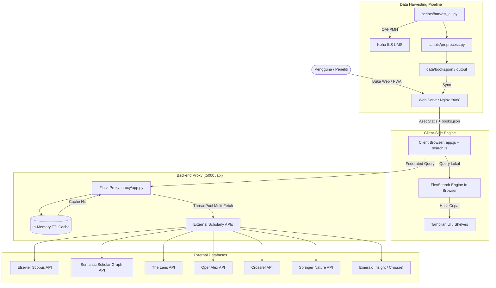

# 📚 Dokumentasi Sistem UMS OneSearch / BookFinder
> **Universitas Muhammadiyah Surakarta Library Discovery System**  
> Terakhir diperbarui: September 2026 | Versi Sistem: v82+

---

## 📑 Daftar Isi
1. [Ringkasan Sistem (System Overview)](#1-ringkasan-sistem-system-overview)
2. [Arsitektur & Diagram Alur Data](#2-arsitektur--diagram-alur-data)
3. [Struktur Direktori & File Penting](#3-struktur-direktori--file-penting)
4. [Konfigurasi Lingkungan (.env)](#4-konfigurasi-lingkungan-env)
5. [Menjalankan Aplikasi (Docker Setup)](#5-menjalankan-aplikasi-docker-setup)
6. [Komponen Utama Frontend](#6-komponen-utama-frontend)
7. [Komponen Utama Backend (Proxy & Harvester)](#7-komponen-utama-backend-proxy--harvester)
8. [Panduan Pemeliharaan & Troubleshooting (Maintenance Guide)](#8-panduan-pemeliharaan--troubleshooting-maintenance-guide)
9. [Daftar Endpoint API (Proxy)](#9-daftar-endpoint-api-proxy)

---

## 1. Ringkasan Sistem (System Overview)
**UMS OneSearch (BookFinder)** adalah portal penemuan pustaka terpadu (*Discovery Platform*) untuk Perpustakaan Universitas Muhammadiyah Surakarta.

Sistem ini menggabungkan dua model pencarian:
1. **Katalog Lokal & Nasional (Offline First / PWA)**:
   - Pencarian koleksi fisik buku Koha Perpustakaan UMS & mitra SLiMS.
   - Tugas akhir (Skripsi, Tesis, Disertasi) dari E-Prints ETD UMS.
   - Jurnal Ilmiah UMS (OJS).
   - Buku Digital Sekolah (Kemdikbud SIBI).
   - Indeks diolah dan di-cache secara lokal di browser menggunakan **FlexSearch**, sehingga pencarian berlangsung instan (< 10ms) bahkan saat offline.
2. **Federated Discovery Internasional**:
   - Agregasi pencarian artikel jurnal ilmiah global secara *real-time* ke berbagai pangkalan data terindeks dunia:
     - **Elsevier Scopus**
     - **Semantic Scholar**
     - **The Lens**
     - **OpenAlex Global OA**
     - **Crossref**
     - **Springer Nature**
     - **Emerald Insight**
   - Dilengkapi fitur ekspor sitasi (APA, MLA, Chicago, file `.RIS`, `.BIB`), QR Code, Smart Insights, dan viewer dokumen PDF in-modal.

---

## 2. Arsitektur & Diagram Alur Data



---

## 3. Struktur Direktori & File Penting

```
harvest-koha/
├── index.html              # Halaman utama aplikasi (PWA Entry Point)
├── admin.html              # Panel administrasi & monitoring panen data
├── sw.js                   # Service Worker (PWA Offline Caching & Cache Versioning)
├── manifest.json           # Manifest instalasi aplikasi PWA
├── docker-compose.yml      # Konfigurasi multi-container (web, api_proxy, scheduler)
├── Dockerfile              # Dockerfile untuk Nginx web server statis
├── .env                    # Variabel konfigurasi & API keys (JANGAN di-commit ke public repo)
├── .env.example            # Template konfigurasi .env
│
├── css/
│   └── style.css           # Seluruh styling aplikasi (Modern Dark/Light System, Badge, Modal, FAB)
│
├── js/
│   ├── app.js              # State UI, router, event listener, modal detail, bookmark, SVG icons
│   ├── search.js           # FlexSearch inisialisasi, fuzzy matching, scoring, facet builder
│   └── recommender.js      # Rekomendasi koleksi berbasis kemiripan DDC & bidang studi
│
├── proxy/
│   ├── app.py              # Backend Flask (Federated search, TTLCache, /api/pdf_proxy streaming)
│   ├── Dockerfile          # Dockerfile untuk python environment gunicorn
│   └── requirements.txt    # Dependensi python backend (Flask, requests, gunicorn, dll.)
│
├── scripts/
│   ├── scheduler.py        # Cron scheduler otomatisasi harvesting
│   ├── harvest_all.py      # Master script untuk panen semua sumber
│   ├── harvest_oai.py      # OAI-PMH harvesting logic
│   ├── preprocess.py       # Data cleansing, DDC classification, chunking JSON
│   ├── build_sqlite.py     # Pembuatan basis data SQLite untuk audit/analisis
│   └── audit_ojs.py        # Validasi metadata artikel jurnal lokal OJS
│
├── data/                   # Raw data hasil harvest & backup data
├── output/                 # Hasil build books.json yang siap disajikan ke publik
├── docs/                   # Dokumentasi teknis & deployment guide
└── img/                    # Aset gambar, logo UMS OneSearch
```

---

## 4. Konfigurasi Lingkungan (.env)
File `.env` berada di root direktori. Berikut variabel penting yang perlu diisi:

```ini
# Port Proxy
PORT=5000

# Kunci API Basis Data Internasional
# Scopus API: Dapatkan dari https://dev.elsevier.com/
SCOPUS_API_KEY=your_scopus_api_key_here

# The Lens API: Dapatkan dari https://www.lens.org/lens/user/subscriptions
LENS_API_KEY=your_lens_api_key_here

# Springer Nature API: Dapatkan dari https://dev.springernature.com/
SPRINGER_API_KEY=your_springer_api_key_here

# Semantic Scholar API (Opsional, memperbesar rate-limit): https://www.semanticscholar.org/product/api
SEMANTIC_SCHOLAR_API_KEY=

# Crossref Polite Pool (Sertakan email perpustakaan untuk masuk ke fast-lane pool)
CROSSREF_MAILTO=perpustakaan@ums.ac.id

# Endpoint OAI-PMH Lokal Koha
KOHA_OAI_URL=https://koha.ums.ac.id/cgi-bin/koha/oai.pl
```

---

## 5. Menjalankan Aplikasi (Docker Setup)

Sistem telah dikemas dalam 3 container Docker terisolasi melalui `docker-compose.yml`:
1. `ums-onesearch` (Nginx di port `8088`)
2. `ums-onesearch-proxy` (Flask Gunicorn di port internal `5000`)
3. `ums-onesearch-scheduler` (Background harvester runner)

### Perintah Operasional Docker:
```bash
# Menjalankan seluruh container di background
docker compose up -d

# Melihat status container yang sedang berjalan
docker compose ps

# Melihat logs real-time proxy API
docker compose logs -f api_proxy

# Restart service proxy (misal setelah ubah .env atau proxy/app.py)
docker compose restart api_proxy

# Stop seluruh layanan
docker compose down
```

Akses web utama dapat dibuka melalui peramban: `http://localhost:8088/` atau `http://<IP-SERVER>:8088/`.

---

## 6. Komponen Utama Frontend

### A. State Manager & UI Lifecycle (`js/app.js`)
* **Theme System (`initTheme`, `toggleTheme`, `setTheme`)**:
  Menyimpan tema `dark` / `light` ke `localStorage` (`bf_theme`). Sinkron dengan atribut `data-theme` pada tag `<html>` dan tombol melayang (FAB) `.theme-toggle-fab`.
* **Badge & Brand Icon System (`getSourceLogoSvg`, `getSourceBadgeHtml`, `getOaBadgeHtml`)**:
  Merender logo SVG resmi untuk Springer, Scopus, OpenAlex, Semantic Scholar, The Lens, Crossref, Emerald, dan icon gembok *Open Access* / *Subscription*.
* **Modal Detail Artikel (`showArticleDetail`)**:
  Pop-up modal terpadu yang menyajikan metadata komprehensif, abstrak utuh, sitasi APA/MLA/Chicago, unduh file `.RIS` / `.BIB`, copy to clipboard, QR code, dan tombol PDF Viewer.
* **In-Modal PDF Streaming Viewer (`openPdfViewer`)**:
  Membuka dokumen PDF langsung di dalam modal menggunakan viewer bawaan atau proxy streaming `/api/pdf_proxy` untuk dokumen Open Access.
* **Koleksi Saya / Bookmarks (`toggleBookmark`, `showBookmarks`)**:
  Menyimpan artikel dan buku favorit ke `localStorage` (`bf-bookmarks`), dilengkapi penanda bintang ⭐ serta counter badge otomatis.

### B. Mesin Pencarian Lokal (`js/search.js`)
* Menggunakan pustaka **FlexSearch** yang sangat cepat untuk memproses puluhan ribu rekaman buku Koha.
* Mengimplementasikan normalisasi teks, stemming sederhana, stopword removal bahasa Indonesia/Inggris, serta scoring bobot pada: Judul (bobot 5x), Pengarang (bobot 3x), Subjek/DDC (bobot 2x).

### C. Service Worker & PWA (`sw.js`)
* Menyediakan fungsionalitas aplikasi web progresif (PWA).
* Melakukan precaching aset penting (HTML, CSS, JS, Gambar).
* **Aturan Cache Versioning**: Setiap kali file `css/style.css` atau `js/app.js` diubah, versi cache di `sw.js` (contoh: `onesearch-shell-v82`) dan parameter query `?v=82` di `index.html` **harus dinaikkan** agar pengguna mendapatkan versi terbaru secara otomatis tanpa tertahan cache browser lama.

---

## 7. Komponen Utama Backend (Proxy & Harvester)

### A. Backend API Proxy (`proxy/app.py`)
Dibangun menggunakan Python Flask dan dijalankan dengan **Gunicorn multi-threading** (`--threads 16`).
1. **Thread-Safe LRU TTL Cache (`TTLCache`)**:
   Menyimpan hasil query federated ke memori selama 45 menit (2700 detik) untuk menghemat kuota API eksternal dan memangkas latency dari ~3 detik menjadi < 20 milidetik pada query yang berulang.
2. **Resilient HTTP Session (`_init_resilient_session`)**:
   Dilengkapi mekanisme *automatic retry* (3x retry) dengan *exponential backoff* dan connection pool untuk menangani lonjakan trafik maupun jaringan eksternal yang tidak stabil.
3. **Endpoint PDF Streaming & Frame Bypass (`/api/pdf_proxy`)**:
   Menangani pembacaan PDF Open Access dari publisher (seperti Springer atau OpenAlex) dengan menghapus header pemblokir iframe (`X-Frame-Options: deny` / CSP `frame-ancestors`) sehingga dokumen dapat dipratinjau secara mulus di browser pengguna.

### B. Pipeline Pemrosesan Data (`scripts/`)
1. `harvest_oai.py`: Mengambil data MARCXML secara bertahap (resumptionToken) dari server Koha UMS.
2. `preprocess.py`: Membersihkan data, memecah pengarang ganda, mengekstrak nomor panggil DDC, mengelompokkan ke kategori fakultas/prodi, lalu mengompresi ke JSON teroptimasi untuk konsumsi web.

---

## 8. Panduan Pemeliharaan & Troubleshooting (Maintenance Guide)

### Skenario 1: Melakukan Perubahan pada Frontend (CSS atau JS)
Jika pengembang mengubah kode di `css/style.css` atau `js/app.js`, lakukan langkah wajib berikut:
1. Buka `index.html`, naikkan parameter query versi:
   ```html
   <link rel="stylesheet" href="css/style.css?v=83">
   <script src="js/app.js?v=83"></script>
   <script>
       navigator.serviceWorker.register('/sw.js?v=83')
   ...
   ```
2. Buka `sw.js`, naikkan konstanta nama cache:
   ```javascript
   const CACHE_NAME_SHELL = 'onesearch-shell-v83';
   const CACHE_NAME_DATA  = 'onesearch-data-v83';
   ```
3. Restart container proxy:
   ```bash
   docker compose restart api_proxy
   ```
*Catatan: Ini mencegah pengguna mengalami cache usang atau layout rusak.*

### Skenario 2: Update Kunci API (Scopus / Springer / Lens)
1. Buka file `.env`.
2. Ganti nilai API key yang baru:
   ```ini
   SCOPUS_API_KEY=kunci_baru_anda
   ```
3. Terapkan perubahan dengan me-restart container proxy:
   ```bash
   docker compose restart api_proxy
   ```
4. Uji endpoint pencarian di browser atau via curl:
   ```bash
   curl "http://localhost:8088/api/federated?source=scopus&q=education"
   ```

### Skenario 3: Menjalankan Panen Ulang Data Koha (Re-Harvest)
Jika ada koleksi buku fisik baru di perpustakaan yang ingin dimasukkan ke dalam sistem:
```bash
# Masuk ke container atau jalankan langsung melalui python environment
python scripts/harvest_all.py
python scripts/preprocess.py
```
File baru akan diperbarui di direktori `output/` dan otomatis dimuat oleh aplikasi web.

### Skenario 4: Memeriksa atau Mengosongkan Cache Memory Proxy
Jika ingin memantau performa cache atau membersihkannya secara manual:
- **Cek Statistik Cache**: Buka browser ke `http://localhost:8088/api/cache/stats`
- **Bersihkan Cache**: Kirim request POST ke `http://localhost:8088/api/cache/clear`

---

## 9. Daftar Endpoint API (Proxy)

| Endpoint | Method | Parameter Utama | Deskripsi |
| :--- | :---: | :--- | :--- |
| `/api/federated` | `GET` | `source`, `q`, `page`, `page_size` | Melakukan pencarian artikel jurnal internasional (Scopus, Springer, S2, Lens, OpenAlex, Crossref, All). |
| `/api/pdf_proxy` | `GET` | `url` | Proxy streaming dokumen PDF Open Access untuk membypass batas X-Frame-Options & CORS. |
| `/api/cache/stats` | `GET` | - | Mengembalikan metrik jumlah item cache, hit rate, hits, dan misses. |
| `/api/cache/clear` | `POST` | - | Mengosongkan in-memory cache proxy. |
| `/api/health` | `GET` | - | Health check status server dan konektivitas. |

---
*Dokumentasi ini disusun untuk menjamin kemudahan pemeliharaan (*maintainability*), skalabilitas, dan keberlanjutan pengembangan sistem UMS OneSearch di masa mendatang.*
